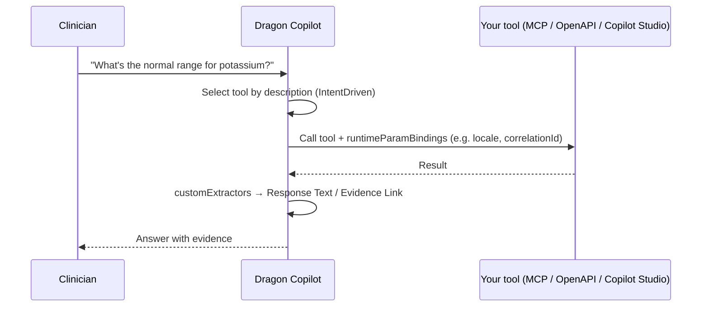

# Dragon Copilot Conversational Extensions

Conversational extensions let Dragon Copilot call **your** tools and agents while a clinician talks to it. Dragon Copilot reads each tool's `description`, decides when the tool is relevant to the user's request (`IntentDriven` trigger), calls it, and blends the result into its answer.

> **Public Preview.** Conversational extensions use the Public Preview manifest schema [`0.4.0-preview.2`](manifest/0.4.0-preview.2/manifest-schema.json). Fields and behavior may change before general availability.

## 📚 Contents

- [Integration types](#-integration-types)
- [Manifest schema 0.4.0-preview.2](#-manifest-schema-040-preview2)
- [Samples](#-samples)
- [CLI](#️-cli)
- [Onboarding](#-onboarding)
- [Quick start](QUICKSTART.md)

## 🧩 Integration types

| Type | You provide | Sample |
| --- | --- | --- |
| **MCP** | A [Model Context Protocol](https://modelcontextprotocol.io/) server (Streamable HTTP). | [`src/samples/Mcp`](src/samples/Mcp/README.md) (C# / ASP.NET Core) |
| **OpenAPI** | A REST API with an OpenAPI 3.x description (`specUrl` or inline `specString`). | [`src/samples/OpenApi`](src/samples/OpenApi/README.md) (C# / ASP.NET Core) |
| **CopilotStudio** | A published [Microsoft Copilot Studio](https://learn.microsoft.com/microsoft-copilot-studio/) agent. | [`src/samples/CopilotStudio`](src/samples/CopilotStudio/README.md) (manifest + setup guide) |

These samples cover the MCP, OpenAPI and CopilotStudio integration types.

### How a call flows



## 📐 Manifest schema 0.4.0-preview.2

- Schema: [`manifest/0.4.0-preview.2/manifest-schema.json`](manifest/0.4.0-preview.2/manifest-schema.json)
- Annotated example (all three types): [`manifest/0.4.0-preview.2/manifest-example.yaml`](manifest/0.4.0-preview.2/manifest-example.yaml)

A manifest opts in by declaring `schemaVersion: 0.4.0-preview.2`; manifests declaring `0.3.0` keep using the GA schema. Workflow extensions ([Physician](../physician/), [Radiologists](../radiologists/)) are unaffected.

### What's new vs. 0.3.0

0.4.0-preview.2 is a superset of 0.3.0 with one intentional tightening.

| Change | Notes |
| --- | --- |
| `customExtractors` | Map JSON paths in a result to `Response Text`, `Evidence Link`, `Evidence Title`, `Evidence Snippet`, … |
| `specString` | Inline OpenAPI document as an alternative to `specUrl`. |
| `isExclusive` | When `true`, the tool's result is not blended with other tools in the same response. |
| `runtimeParamBindings` | Send platform runtime values (transcript, locale, conversationId, correlationId, …) to the tool without the model retyping them. |
| Trigger/type alignment (tightening) | `DragonAPI` → `DataAvailable` / `ExplicitRequest`; every other type → `IntentDriven`. |

### Common tool fields

| Field | Required | Notes |
| --- | --- | --- |
| `name` | ✅ | Unique in the manifest; lowercase, digits, hyphens. |
| `caption` | ✅ | Display name. |
| `description` | ✅ | **Dragon Copilot's selection prompt.** Say *when* to use the tool. |
| `type` | ✅ | `MCP`, `OpenAPI` or `CopilotStudio`. |
| `triggers` | ✅ | `[IntentDriven]` for conversational tools. |
| `timeout` | | Seconds, 3–60 (default 5). |
| `isExclusive` | | Don't blend with other tools. |

### Type-specific fields

| Field | MCP | OpenAPI | CopilotStudio |
| --- | --- | --- | --- |
| `endpoint` | ✅ MCP URL | — | — |
| `specUrl` / `specString` | — | ✅ one of | — |
| `expose` | MCP tool names | operationIds | — |
| `customExtractors` | keyed by MCP tool | keyed by operationId | — |
| `runtimeParamBindings` | keyed by MCP tool; `target` required: `argument`, `header`, `sideChannel` (`_meta`) | keyed by operationId; `target`: `body` (default), `header` | flat list; `target`: `intent` (default), `sideChannel` |
| `environmentId`, `agentIdentifier` | — | — | ✅ |
| `cloud`, `agentType` | — | — | optional |

### Runtime parameter bindings

Bindings tell the platform to inject a runtime value into the outbound call. You only choose the **source**, the **target** and the **path**:

```yaml
runtimeParamBindings:
  extract_orders:            # MCP tool name / OpenAPI operationId
    - source: transcript
      target: argument       # MCP tool-call argument
      path: transcript
      required: true         # skip the call when the value is missing
    - source: conversationId
      target: sideChannel    # MCP _meta, hidden from the model
      path: dragon.conversationId
```

Supported sources are listed in the schema (`RuntimeParamSource`). Sources that carry PHI/EUII (for example `transcript`, `patientContext`, `mrn`) are never logged by the platform; treat them with the same care in your service.

## 🧪 Samples

| Sample | Run | Port |
| --- | --- | --- |
| [MCP](src/samples/Mcp/README.md) | `dotnet run --project src/samples/Mcp/SampleConversational.Mcp.Web` | 5190 |
| [OpenAPI](src/samples/OpenApi/README.md) | `dotnet run --project src/samples/OpenApi/SampleConversational.OpenApi.Web` | 5191 |
| [Copilot Studio](src/samples/CopilotStudio/README.md) | Hosted in Copilot Studio | — |

Build and test both .NET samples:

```bash
dotnet test conversational/src/samples/SampleConversational.slnx
```

All sample data is synthetic and for demonstration only — not for clinical use.

## 🛠️ CLI

The [Dragon Copilot CLI](../tools/dragon-copilot-cli/README.md) has a `conversational` command group:

```bash
dragon-copilot conversational init --type MCP              # New extension.yaml
dragon-copilot conversational generate --template openapi  # Add a tool (mcp | openapi | copilot-studio)
dragon-copilot conversational validate extension.yaml      # Validate against 0.4.0-preview.2
dragon-copilot conversational package                      # Validate + zip for upload
```

## 🚀 Onboarding

1. Host your MCP server or OpenAPI service on a public HTTPS endpoint (or publish your Copilot Studio agent).
2. Configure authentication — see [Authentication](../doc/Authentication.md).
3. `dragon-copilot conversational package` to produce the upload package.
4. Upload (sideload) the package for your organization in the Dragon admin center, or publish it through the [marketplace](https://admin.healthplatform.microsoft.com/marketplace).
5. Ask Dragon Copilot one of the sample's test prompts.

Conversational extensions are in Public Preview: fields and behavior may change before general availability, so re-run `dragon-copilot conversational validate` when the schema is updated.
