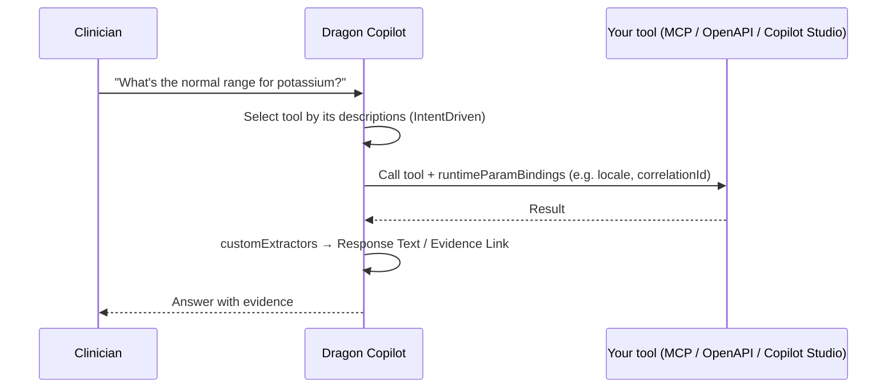

# Dragon Copilot Conversational Extensions

Conversational extensions let Dragon Copilot call **your** tools and agents while a clinician talks to it. Dragon Copilot reads your tools' descriptions, decides when a tool is relevant to the user's request (`IntentDriven` trigger), calls it, and blends the result into its answer. Which description it reads depends on the tool type; see [Writing tool descriptions](TOOL-DESCRIPTIONS.md).

In this guide, **intent** means what the clinician is asking for in the current turn (for example "what's the normal potassium range?"). An `IntentDriven` tool is called when Dragon Copilot judges, from that request and the tool's descriptions, that the tool can help answer it.

> **Public Preview.** Conversational extensions use the Public Preview manifest schema [`0.4.0-preview.2`](../tools/dragon-copilot-cli/src/schemas/physician/physician-extension-manifest-schema-0.4.0-preview.2.json). Fields and behavior may change before general availability.

## 📚 Contents

- [Integration types](#-integration-types)
- [Manifest schema 0.4.0-preview.2](#-manifest-schema-040-preview2)
- [Samples](#-samples)
- [CLI](#️-cli)
- [How Dragon Copilot calls your tool](#how-dragon-copilot-calls-your-tool)
- [Onboarding](#-onboarding)
- [Writing tool descriptions](TOOL-DESCRIPTIONS.md)
- [Evaluating your extension end to end](tools/conversational-eval/README.md)
- [Quick start](src/samples/DragonCopilot/Conversational/README.md)

## 🧩 Integration types

| Type | You provide | Sample |
| --- | --- | --- |
| **MCP** | A [Model Context Protocol](https://modelcontextprotocol.io/) server (Streamable HTTP). | [`src/samples/DragonCopilot/Conversational/Mcp`](src/samples/DragonCopilot/Conversational/Mcp/README.md) (C# / ASP.NET Core) |
| **OpenAPI** | A REST API with an OpenAPI 3.x description (`specUrl` or inline `specString`). | [`src/samples/DragonCopilot/Conversational/OpenApi`](src/samples/DragonCopilot/Conversational/OpenApi/README.md) (C# / ASP.NET Core) |
| **CopilotStudio** | A published [Microsoft Copilot Studio](https://learn.microsoft.com/microsoft-copilot-studio/) agent. | [`src/samples/DragonCopilot/Conversational/CopilotStudio`](src/samples/DragonCopilot/Conversational/CopilotStudio/README.md) (manifest + setup guide) |

These samples cover the MCP, OpenAPI and CopilotStudio integration types.

### How a call flows



## 📐 Manifest schema 0.4.0-preview.2

- Schema: [`physician-extension-manifest-schema-0.4.0-preview.2.json`](../tools/dragon-copilot-cli/src/schemas/physician/physician-extension-manifest-schema-0.4.0-preview.2.json)
- **Field reference** (every field, trigger, content type, binding source/target and extractor): [`manifest/0.4.0-preview.2/README.md`](manifest/0.4.0-preview.2/README.md)
- Annotated example (all three types): [`manifest/0.4.0-preview.2/manifest-example.yaml`](manifest/0.4.0-preview.2/manifest-example.yaml)

A manifest opts in by declaring `schemaVersion: 0.4.0-preview.2`; manifests declaring `0.3.0` keep using the GA (0.3.0) schema, so existing Workflow (`DragonAPI`) manifests and [Radiologists](../radiologists/) extensions do not change unless you move them to 0.4.0-preview.2.

### What's new vs. 0.3.0

| Change | Notes |
| --- | --- |
| `customExtractors` | Map JSON paths in a result to `Response Text`, `Evidence Link`, `Evidence Title`, `Evidence Snippet`, … |
| `specString` | Inline OpenAPI document as an alternative to `specUrl`. |
| `isExclusive` | When `true`, the tool's result is not blended with other tools in the same response. |
| `runtimeParamBindings` | Send platform runtime values (transcript, locale, conversationId, correlationId, …) to the tool without the model retyping them. |
| `IntentDriven` trigger | New trigger value for conversational tools. |
| New tool types | `MCP`, `OpenAPI`, `CopilotStudio`, each with its own fields (see below). |

### Breaking changes when moving a 0.3.0 manifest to 0.4.0-preview.2

| Change | Effect |
| --- | --- |
| `schemaVersion` | Must be `0.4.0-preview.2`. |
| `timeout` minimum raised from 3 to 5 | A tool with `timeout: 3` or `timeout: 4` no longer validates. Allowed range is 5–60 seconds. |
| Trigger/type alignment | `DragonAPI` tools accept only `DataAvailable` / `ExplicitRequest` (`IntentDriven` is rejected); every other type accepts only `IntentDriven`. 0.3.0 had no `IntentDriven`, so valid 0.3.0 triggers are unaffected. |
| Type-specific fields | Each field is accepted only on the tool types that use it. For example, `DragonAPI` tools reject `expose`, `specUrl`, `customExtractors`, `runtimeParamBindings`, `isExclusive` and `environmentId`, and conversational tools reject `inputs` / `outputs`. Unknown tool fields are rejected, as in 0.3.0. |

### Common tool fields

| Field | Required | Notes |
| --- | --- | --- |
| `name` | ✅ | Unique in the manifest; lowercase, digits, hyphens. |
| `caption` | ✅ | Display name. |
| `description` | ✅ | What the tool does. `CopilotStudio`: the whole selection description. `MCP` and `OpenAPI`: short server notes shared by all the server's tools or operations, given to the model once per server; each MCP tool's or OpenAPI operation's own description and parameters decide when it is called. See [Writing tool descriptions](TOOL-DESCRIPTIONS.md). |
| `type` | ✅ | `MCP`, `OpenAPI` or `CopilotStudio`. |
| `triggers` | ✅ | `[IntentDriven]` for conversational tools. |
| `timeout` | | Seconds, 5–60 (default 5). |
| `isExclusive` | | Don't blend with other tools. |

### Type-specific fields

| Field | MCP | OpenAPI | CopilotStudio |
| --- | --- | --- | --- |
| `endpoint` | ✅ MCP URL | — | — |
| `specUrl` / `specString` | — | ✅ one of | — |
| `expose` | MCP tool names | operationIds | — |
| `customExtractors` | keyed by MCP tool | keyed by operationId | — |
| `runtimeParamBindings` | keyed by MCP tool; `target` required: `argument`, `header`, `sideChannel` (`_meta`) | keyed by operationId; `target`: `body` (default), `header` | flat list; `target`: `intent` (default), `sideChannel` |
| `environmentId`, `agentIdentifier` | — | — | ✅ |
| `cloud`, `agentType` | — | — | optional |

### Runtime parameter bindings

Bindings tell the platform to inject a runtime value into the outbound call. You only choose the **source**, the **target** and the **path**:

```yaml
runtimeParamBindings:
  extract_orders:            # MCP tool name / OpenAPI operationId
    - source: transcript
      target: argument       # MCP tool-call argument
      path: transcript
      required: true         # most sources: skip the call when missing (see note on transcript below)
    - source: conversationId
      target: sideChannel    # MCP _meta, hidden from the model
      path: dragon.conversationId
```

Supported sources are listed in the schema (`RuntimeParamSource`). See the [full source and target tables](manifest/0.4.0-preview.2/README.md#runtime-parameter-bindings).

- `transcript` sends the transcript as a JSON **object** in Dragon Standard Payload (DSP) format: `{ "transcript": { "turns": [ { "index": 0, "speaker": "...", "text": "..." } ] } }`. `transcriptTurns` sends only the inner object (`{ "turns": [...] }`) for services that expect the turns without the wrapper. Neither is a plain string, so declare the parameter as an object.
- The transcript may be unavailable on a request (for example, before anything has been said). `required: true` does not guarantee a transcript value, so handle a missing transcript in your tool.
- Sources that carry PHI/EUII (for example `transcript`, `transcriptTurns`, `patientContext`, `mrn`) are treated as PHI/EUII by Dragon Copilot; handle them with the same care in your service and never log their values.

#### Bound fields and the model

Declare every bound field in your tool's contract (MCP `inputSchema` argument, or OpenAPI request-body property / header) as an **optional** field, so the contract is accurate for any client. For `MCP` arguments and `OpenAPI` body and header targets, Dragon Copilot removes bound fields from the tool definition its model sees, ignores any value the model supplies for them, and sends the bound value instead. When the value is missing, an optional field is omitted; a field your spec marks as required receives the placeholder `N/A` if your schema accepts it, otherwise the call is not made. Do not mark a bound field as required in your spec unless it always has a value. Bindings cannot target reserved HTTP headers such as `Authorization`, `Cookie`, `Host` or `Content-Type`.

### Example: optional `patientContext`

All three samples bind `patientContext` (the current patient context, a JSON object) with `required: false`, so the call still runs when it is missing. It is **PHI**: log the source name only, never the value.

| Sample | Target | Path | Notes |
| --- | --- | --- | --- |
| [MCP](src/samples/DragonCopilot/Conversational/Mcp/) | `argument` | `patientContext` | Optional tool argument. `sideChannel` is also supported. |
| [OpenAPI](src/samples/DragonCopilot/Conversational/OpenApi/) | `body` | `patientContext` | Optional request-body property, declared in the published OpenAPI document. `header` is also supported. |
| [Copilot Studio](src/samples/DragonCopilot/Conversational/CopilotStudio/) | `intent` | `patient_context` | Labelled value in the query sent to the agent. `sideChannel` is also supported. |

## 🧪 Samples

| Sample | Run | Port |
| --- | --- | --- |
| [MCP](src/samples/DragonCopilot/Conversational/Mcp/README.md) | `dotnet run --project physician/src/samples/DragonCopilot/Conversational/Mcp/SampleConversational.Mcp.Web` | 5190 |
| [OpenAPI](src/samples/DragonCopilot/Conversational/OpenApi/README.md) | `dotnet run --project physician/src/samples/DragonCopilot/Conversational/OpenApi/SampleConversational.OpenApi.Web` | 5191 |
| [Copilot Studio](src/samples/DragonCopilot/Conversational/CopilotStudio/README.md) | Hosted in Copilot Studio | — |

Build and test both .NET samples:

```bash
dotnet test physician/src/samples/DragonCopilot/Conversational/SampleConversational.slnx
```

All sample data is synthetic and for demonstration only — not for clinical use.

## 🛠️ CLI

The [Dragon Copilot CLI](../tools/dragon-copilot-cli/README.md) supports conversational tools through the `physician` command group with `--schema-version 0.4.0-preview.2`:

```bash
dragon-copilot physician init --schema-version 0.4.0-preview.2 --type MCP   # New extension.yaml
dragon-copilot physician generate --schema-version 0.4.0-preview.2 --template openapi   # Template (mcp | openapi | copilot-studio)
dragon-copilot physician validate extension.yaml   # Validates against the declared schemaVersion
dragon-copilot physician package                   # Validate + zip for upload
```

## How Dragon Copilot calls your tool

| Type | What Dragon Copilot calls | How to protect it |
| --- | --- | --- |
| `MCP` | Your `endpoint` over HTTPS using MCP Streamable HTTP (`tools/list`, `tools/call`). | Require a Microsoft Entra ID app-only bearer token, as in the [MCP sample](src/samples/DragonCopilot/Conversational/Mcp/README.md#authentication). |
| `OpenAPI` | The operations in your spec, at the URL in the spec's `servers` entry, over HTTPS. | Require a Microsoft Entra ID app-only bearer token, as in the [OpenAPI sample](src/samples/DragonCopilot/Conversational/OpenApi/README.md#authentication). Keep `specUrl` reachable by Dragon Copilot. |
| `CopilotStudio` | Your published agent in the given `environmentId` and `cloud`. You host no endpoint. | Dragon Copilot calls the agent **on behalf of the signed-in clinician** (OBO), so the agent runs with the clinician's identity and permissions. Manage access to the agent in Copilot Studio. `auth.tenantId` is ignored for manifests whose tools are all `CopilotStudio`. |

The rest of this section applies to `MCP` and `OpenAPI` only. The MCP and OpenAPI samples follow the token-validation pattern in [Authentication](../doc/Authentication.md) and [Authentication Design](../doc/AuthenticationDesign.md):

- Validate the token signature, issuer (your `auth.tenantId` tenant) and audience (your app registration's client ID).
- Accept only app-only tokens (`idtyp` = `app`).
- Accept only the Dragon Copilot Extension Runtime as caller (`azp` or `appid` claim = `d9350f5d-71c2-46b9-b41d-3c5d51ffe6e8`). `MCP` and `OpenAPI` tools use the same service-to-service (app-only) flow as `DragonAPI` tools; see [Authentication Design](../doc/AuthenticationDesign.md).
- Keep authentication on in every deployed environment. The samples turn it off only in `Development`.

## 🚀 Onboarding

1. Host your MCP server or OpenAPI service on a public HTTPS endpoint (or publish your Copilot Studio agent).
2. Configure authentication — see [How Dragon Copilot calls your tool](#how-dragon-copilot-calls-your-tool) and [Authentication](../doc/Authentication.md).
3. `dragon-copilot physician package` to produce the upload package.
4. Upload (sideload) the package for your organization in the Dragon admin center, or publish it through the [marketplace](https://admin.healthplatform.microsoft.com/marketplace).
5. Ask Dragon Copilot one of the sample's test prompts.
6. Run your own list of clinician questions with the [evaluation kit](tools/conversational-eval/README.md) and tune your descriptions until the right tool is called. To automate the loop, give the kit's [agent skill](tools/conversational-eval/SKILL.md) to your favorite LLM coding agent.

Conversational extensions are in Public Preview: fields and behavior may change before general availability, so re-run `dragon-copilot physician validate` when the schema is updated.
