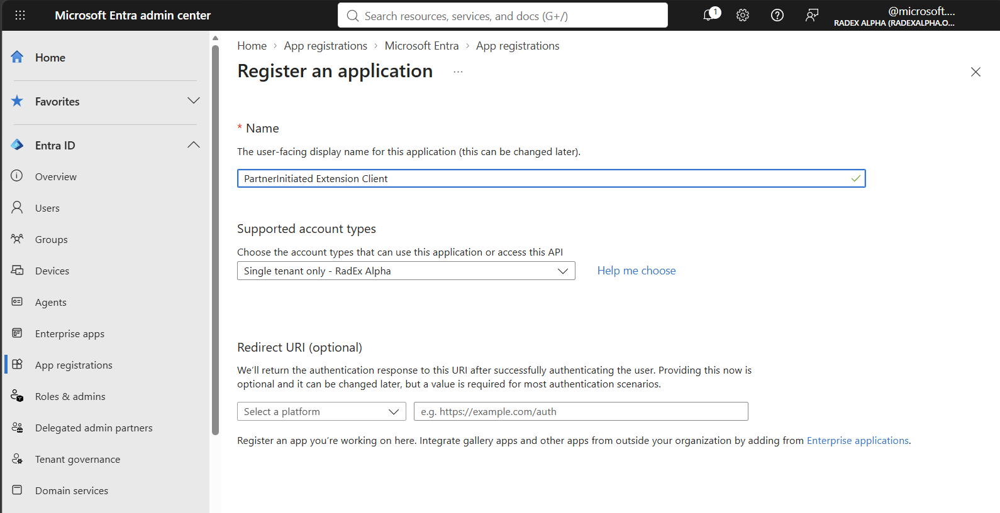
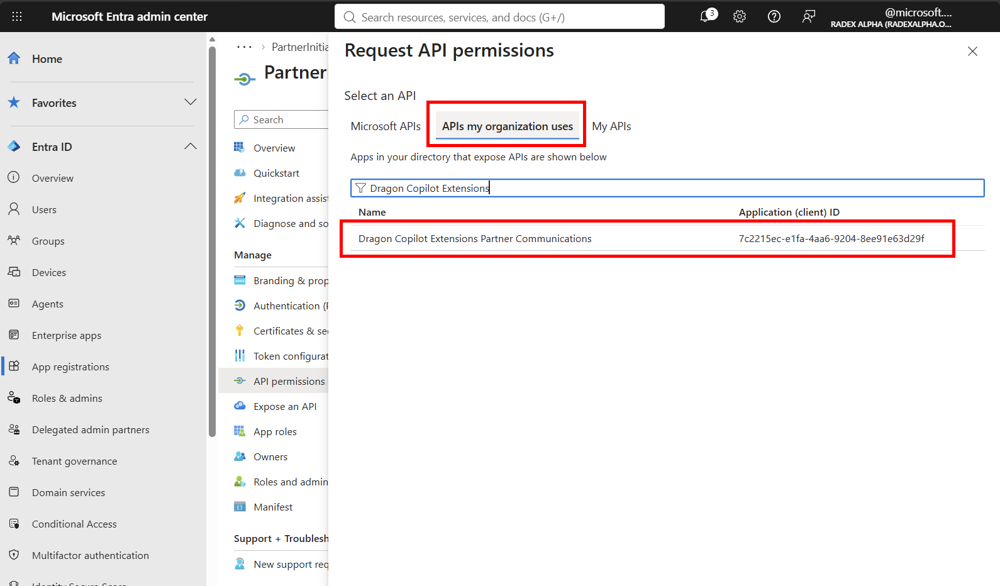
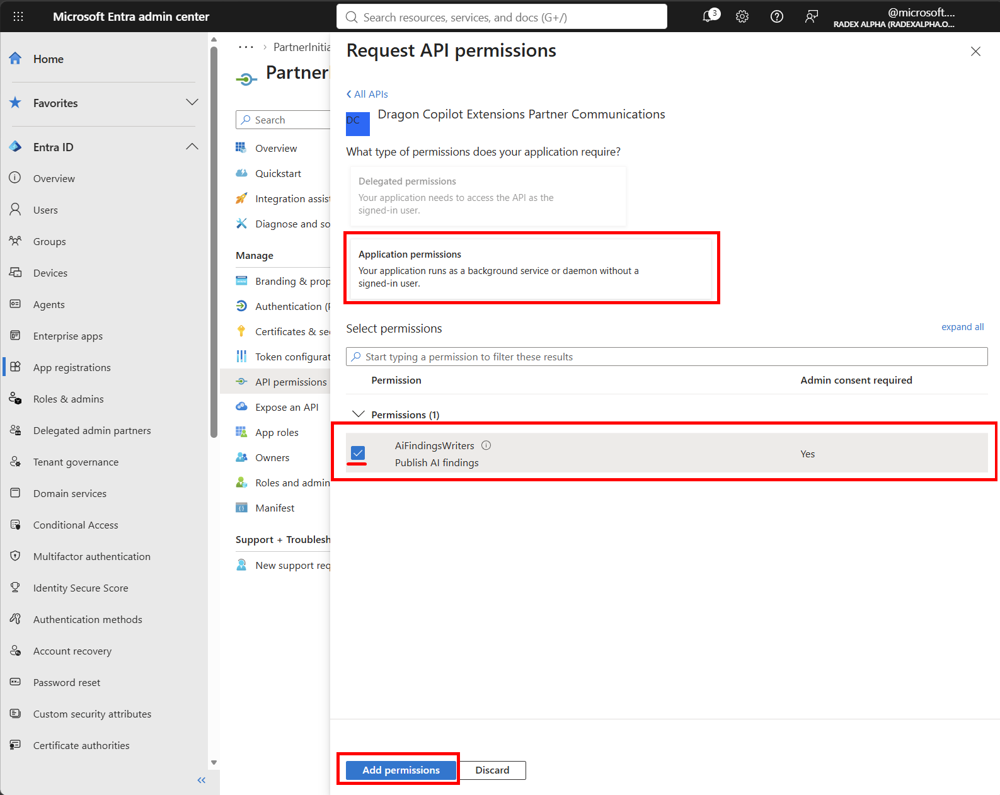
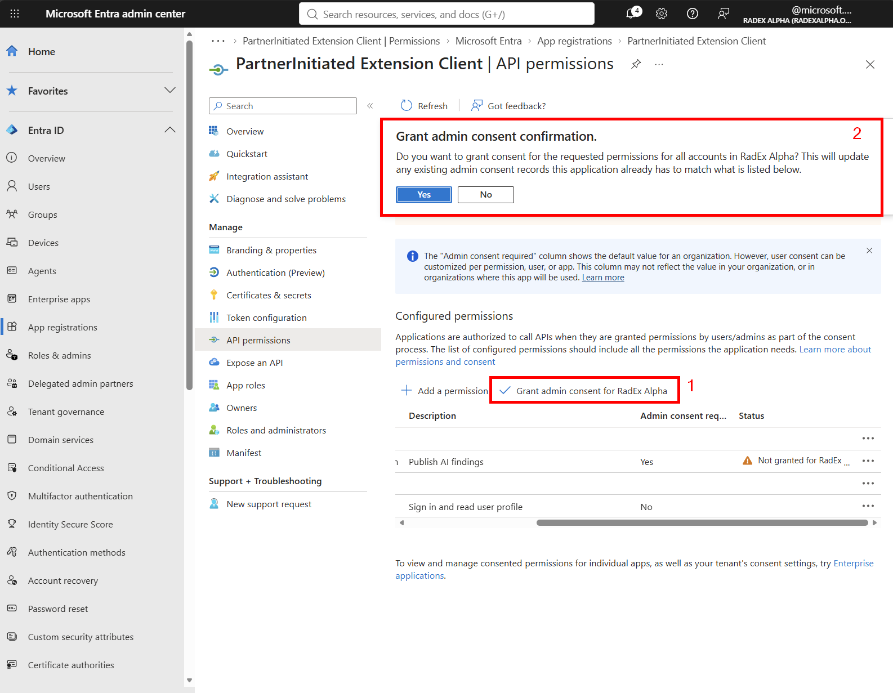

# Inbound Partner Authentication

A `partnerInitiated` tool uses service-to-service authentication to submit results without a signed-in user. Its Extension workload authenticates using a Partner-owned Microsoft Entra app registration and the [OAuth 2.0 client credentials flow](https://learn.microsoft.com/entra/identity-platform/v2-oauth2-client-creds-grant-flow).

## Conventions used in this document

| Term | Meaning |
| --- | --- |
| Partner tenant | The Microsoft Entra tenant whose ID is declared in the [extension manifest](../README.md) as `auth.tenantId` and appears in the access token's `tid` claim. |
| Partner app registration | The Microsoft Entra app registration used by the Extension workload to acquire access tokens. |
| Extension workload | The Partner-operated software that acquires an access token and submits results to Dragon Copilot. |
| Partner Communications API | The Microsoft Entra-protected resource for which the Extension workload requests an access token. |

## Authentication flow

Partner authentication associates an extension with its Partner tenant through the tenant ID. Manifest development and identity configuration can happen in either order, but both depend on an established Partner tenant.

- The manifest identifies the Partner tenant through `auth.tenantId`.
- A Partner app registration is created in that tenant.
- The app registration is granted the Partner Communications API `AiFindingsWriters` [application permission](https://learn.microsoft.com/entra/identity-platform/permissions-consent-overview#types-of-permissions).
- The Extension workload authenticates using that app registration and requests an app-only access token.
- The token's `tid` claim must match the manifest's `auth.tenantId`.

This document focuses on an approach that is agnostic to where the Extension workload runs, so it does not need to run in the same tenant as the app registration. The app registration belongs to the Partner tenant represented by the token's `tid` claim. The Extension workload acts as an OAuth confidential client when requesting tokens.

## Prerequisites

You need:

- An Azure or Microsoft Entra tenant and the tenant ID to declare as the manifest's `auth.tenantId`.
- An administrator who can create applications, create enterprise applications, and grant admin consent in that tenant.
- Access to [Azure Cloud Shell](https://learn.microsoft.com/azure/cloud-shell/overview) or a local installation of the [Azure CLI](https://learn.microsoft.com/cli/azure/install-azure-cli).
- The Partner Communications application ID: `7c2215ec-e1fa-4aa6-9204-8ee91e63d29f`.

## Configure the tenant

### Create the Partner app registration

Registering a Microsoft Entra application establishes a client identity used by the Extension workload.

1. Sign in to the [Microsoft Entra admin center](https://entra.microsoft.com).
2. If you can access multiple tenants, switch to the Partner tenant and verify its tenant ID.
3. Open **Entra ID → App registrations** and select **New registration**.
4. Create a single-tenant application. Choose a descriptive name and leave the redirect URI unconfigured.
5. Note the **Application (client) ID**. The Extension workload uses it when requesting an access token.



Use the Partner tenant ID as the extension manifest's `auth.tenantId`.

> **Managed identity:** An Extension workload running on a supported Azure resource in the Partner tenant may be able to use managed identity instead of managing an application credential. That configuration is not yet covered by this guide.

### Add Partner Communications to the tenant

Use Azure Cloud Shell or Azure CLI to create the Partner Communications enterprise application in the Partner tenant.

If you use Cloud Shell, open it from the [Azure portal](https://portal.azure.com) or [shell.azure.com](https://shell.azure.com) and select **PowerShell**. Cloud Shell is not available from the Microsoft Entra admin center.

First, define the Partner tenant and Partner Communications application IDs:

```pwsh
$partnerTenantId = "<partner-tenant-id>"
$partnerCommunicationsClientId = "7c2215ec-e1fa-4aa6-9204-8ee91e63d29f"
```

Sign in to the Partner tenant. `--allow-no-subscriptions` supports tenants where the administrator has directory access but no Azure subscription:

```pwsh
az login --tenant $partnerTenantId --allow-no-subscriptions
```

Verify the active tenant before creating the enterprise application:

```pwsh
az account show --query '{tenantId:tenantId,user:user.name}' --output table
```

Create the tenant-local Partner Communications service principal:

```pwsh
az ad sp create --id $partnerCommunicationsClientId
```

Verify **Dragon Copilot Extensions Partner Communications** under **Entra ID → Enterprise apps** in the Microsoft Entra admin center.

### Grant the application permission

1. Return to the Partner app registration in the [Microsoft Entra admin center](https://entra.microsoft.com) and open **API permissions**.
2. Select **Add a permission → APIs my organization uses**.
3. Search for **Dragon Copilot Extensions Partner Communications**, or search using application ID `7c2215ec-e1fa-4aa6-9204-8ee91e63d29f`.

   

4. Select **Application permissions → AiFindingsWriters — Publish AI findings**, and then select **Add permissions**.

   

5. Select **Grant admin consent** and confirm the operation. For more information, see [Grant tenant-wide admin consent to an application](https://learn.microsoft.com/entra/identity/enterprise-apps/grant-admin-consent).

   

> **Microsoft Graph `User.Read`:** Microsoft Entra adds this delegated permission to new app registrations by default. Client credentials do not use delegated permissions because no user signs in. Applications that do not support user sign-in should typically remove it.

## Choose a client credential

The Extension workload uses a client credential to authenticate as the service principal associated with the Partner app registration.

| Credential | Guidance |
| --- | --- |
| [Federated credential](https://learn.microsoft.com/entra/workload-id/workload-identity-federation) | Prefer when the hosting platform provides a supported workload identity or OpenID Connect issuer. No shared secret or certificate private key needs to be stored by the Extension workload. |
| [Certificate](https://learn.microsoft.com/entra/identity-platform/certificate-credentials) | Use when federation is unavailable and the Extension workload can securely manage a private key and certificate lifecycle. |
| [Client secret](https://learn.microsoft.com/entra/identity-platform/how-to-add-credentials?tabs=client-secret#add-a-credential-to-your-application) | Can be used for initial validation. It is not an acceptable long-term credential and should be deleted promptly after validation. |

See [Add and manage app credentials in Microsoft Entra ID](https://learn.microsoft.com/entra/identity-platform/how-to-add-credentials) for credential configuration in the Microsoft Entra admin center.

## Validate the identity setup

Before integrating token acquisition into the production Extension workload, request an app-only access token for the Partner Communications API using the following HTTP request or an equivalent API client.

The token request is an HTTP `POST` with a form-encoded body. For example, the following request uses a short-lived client secret:

```bash
curl --request POST \
  --url "https://login.microsoftonline.com/<partner-tenant-id>/oauth2/v2.0/token" \
  --header "Content-Type: application/x-www-form-urlencoded" \
  --data-urlencode "client_id=<partner-application-client-id>" \
  --data-urlencode "client_secret=<short-lived-client-secret>" \
  --data-urlencode "scope=7c2215ec-e1fa-4aa6-9204-8ee91e63d29f/.default" \
  --data-urlencode "grant_type=client_credentials"
```

Avoid placing a long-lived credential directly in a command or shell history.

| Token request value | Value |
| --- | --- |
| Token endpoint | `https://login.microsoftonline.com/{partnerTenantId}/oauth2/v2.0/token` |
| Client ID | The Partner app registration's **Application (client) ID** |
| Scope | `7c2215ec-e1fa-4aa6-9204-8ee91e63d29f/.default` |
| Grant type | `client_credentials` |
| Client authentication | The client secret, certificate, or federated assertion configured for the Partner app registration |

A successful token request confirms the identity infrastructure can work as expected. For setup and debugging, decode the access token using the Microsoft-hosted [jwt.ms](https://jwt.ms) tool and confirm the following claims:

| Claim | Expected value |
| --- | --- |
| `aud` | `7c2215ec-e1fa-4aa6-9204-8ee91e63d29f` |
| `azp` | The Partner app registration's client ID |
| `tid` | The manifest's `auth.tenantId` |
| `roles` | Contains `AiFindingsWriters` |
| `idtyp` | `app` |

The `azp` claim confirms which app registration acquired the token; it does not identify the extension. The extension manifest does not declare or match an application client ID. Dragon Copilot associates the submission with the Partner tenant using `tid` and resolves the extension using the request and installed manifest.

> **Access-token handling:** Claim inspection is for setup and debugging only. Use `jwt.ms` only for this temporary validation step; do not log, persist, or otherwise distribute the token. Production clients should treat [access tokens](https://learn.microsoft.com/entra/identity-platform/access-tokens) as opaque strings. The receiving API is responsible for validating them.

Send the token with each result submission:

```http
Authorization: Bearer <access-token>
```

See [Submitting a result](README.md#submitting-a-result) for the endpoint and request body.

Successful token acquisition validates the Microsoft Entra configuration. It does not validate customer-environment routing, extension installation, or other aspects of `partnerInitiated` authorization. Those checks are described in [How a submission is matched](README.md#how-a-submission-is-matched).

## Implement token acquisition

Using a library that supports the Microsoft Identity Platform in the Extension workload rather than manually implementing OAuth requests is strongly recommended. The [Microsoft Authentication Library (MSAL)](https://learn.microsoft.com/entra/identity-platform/msal-overview) supports application token acquisition and token caching across several languages and frameworks.

The production implementation should:

- Use the Partner tenant's tenant-specific authority. Do not use the `common` or `organizations` authority for client credentials.
- Request the Partner Communications API `/.default` scope.
- Use the production credential selected for the Extension workload's hosting environment.
- Reuse the identity-library client or credential instance so its application token cache can be used.
- Acquire and attach tokens without parsing their claims in normal application flow.

For .NET applications:

- [MSAL.NET client credential flows](https://learn.microsoft.com/entra/msal/dotnet/acquiring-tokens/web-apps-apis/client-credential-flows) documents `AcquireTokenForClient`, application token caching, and certificate-based clients.
- [Azure Identity authentication best practices](https://learn.microsoft.com/dotnet/azure/sdk/authentication/best-practices) explains explicit production credentials, credential reuse, and token caching.

The following MSAL.NET example is for illustrative purposes only and assumes `partnerTenantId` and `partnerClientId` are loaded from configuration and `certificate` is loaded from a hypothetical secure certificate store. Create the confidential-client instance once and reuse it so MSAL can use its application token cache:

```csharp
var scopes = new[]
{
    "7c2215ec-e1fa-4aa6-9204-8ee91e63d29f/.default"
};

var client = ConfidentialClientApplicationBuilder
    .Create(partnerClientId)
    .WithAuthority($"https://login.microsoftonline.com/{partnerTenantId}")
    .WithCertificate(certificate)
    .Build();

var result = await client
    .AcquireTokenForClient(scopes)
    .ExecuteAsync();

string accessToken = result.AccessToken;
```

Choose the library and credential implementation that fit the Extension workload's hosting model.

> **Azure Identity:** When using `Azure.Identity` in production, select an explicit `TokenCredential` for the configured Partner app registration. If a credential chain selects a developer or operator identity instead, the token can contain the wrong tenant or client and produce confusing authorization failures.

## Related content

- [Application objects and service principal objects](https://learn.microsoft.com/entra/identity-platform/app-objects-and-service-principals)
- [Microsoft identity platform integration checklist](https://learn.microsoft.com/entra/identity-platform/identity-platform-integration-checklist)
- [Microsoft identity platform documentation](https://learn.microsoft.com/entra/identity-platform/)
